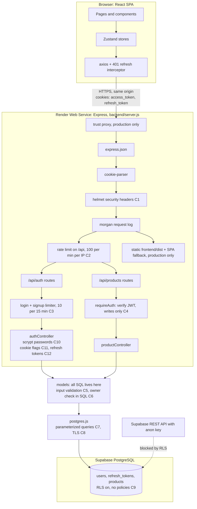
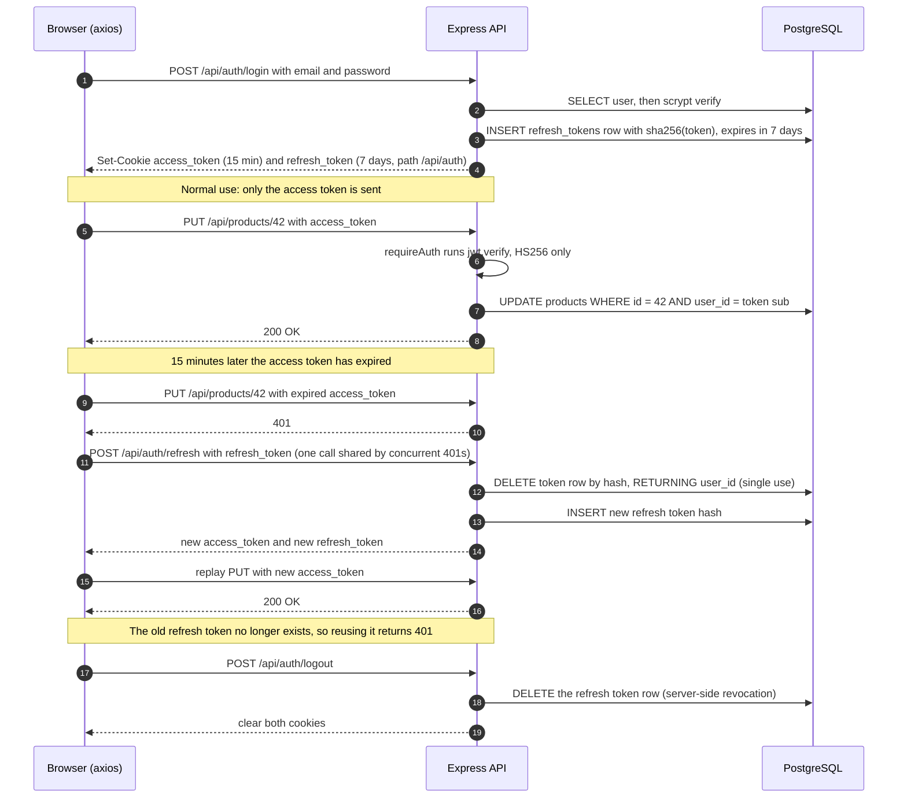

<h1 align="center">Product Listing App</h1>

A full-stack product catalog: anyone can browse, logged-in users can list products, and only a product's owner can edit or delete it.

- **Frontend:** React 19, Vite, Tailwind CSS + DaisyUI, Zustand, React Router
- **Backend:** Node.js, Express, `postgres` (postgres.js)
- **Database:** PostgreSQL on Supabase
- **Auth:** JWT access token (15 min) + rotating, revocable refresh token (7 days), httpOnly cookies
- **Hosting:** one Render Web Service serves the API and the built frontend

## Architecture and request flow

Production is a single origin: Express serves both `/api/*` and the built React app, so auth cookies never cross origins and no CORS is needed. In development, Vite (`:5173`) proxies `/api` to Express (`:3000`) to keep the same single-origin setup.

Every request passes the middleware chain top to bottom. Labels `C1`–`C13` mark where each security control sits; they are described in [Security controls](#security-controls).



Reads (`GET /api/products`, `GET /api/products/:id`) are public. Writes (`POST`, `PUT`, `DELETE`) go through `requireAuth`, and updates/deletes only touch rows where `user_id` matches the token.

## Token lifecycle

Two cookies, two jobs:

| Cookie          | Contents                         | Lifetime | Sent to            | Stored server-side               |
| --------------- | -------------------------------- | -------- | ------------------ | -------------------------------- |
| `access_token`  | JWT (HS256), `sub` = user id     | 15 min   | every path (`/`)   | no, verified by signature        |
| `refresh_token` | 256-bit random value (not a JWT) | 7 days   | only `/api/auth/*` | SHA-256 hash in `refresh_tokens` |



Notes:

- **Rotation:** every refresh deletes the old token and issues a new pair, so each refresh token works exactly once.
- **Logout is real:** deleting the row means a copied refresh token stops working immediately. An already-issued access token stays valid until it expires (at most 15 minutes).
- **Frontend:** the interceptor in `frontend/src/store/useAuthStore.js` refreshes once on a 401 and replays the request. It never retries `login`, `signup`, `refresh` or `logout`.
- **Housekeeping:** each login deletes that user's expired refresh tokens.

## Security controls

| # | Control | Where |
| --- | --- | --- |
| C1 | Security headers via `helmet` (CSP disabled, see limitations) | `backend/server.js` |
| C2 | Rate limit: 100 requests/min per IP on all `/api` routes | `backend/server.js` |
| C3 | Brute-force limit: 10 attempts per 15 min per IP, shared by login and signup | `backend/routes/authRoutes.js` |
| C4 | JWT verification on write routes, algorithm pinned to HS256 | `backend/lib/auth.js` (`requireAuth`) |
| C5 | Input validation: email format, password ≥ 8 chars, product name, price range, `http(s)` image URL, numeric ids only | `backend/models/userModel.js`, `backend/models/productModel.js`, `productRoutes.js` |
| C6 | Ownership enforced in the query itself: `WHERE id = $1 AND user_id = $2` | `backend/models/productModel.js` |
| C7 | SQL injection prevention: every query uses postgres.js tagged-template parameters | `backend/models/` |
| C8 | TLS to the database (`ssl: "require"`) | `backend/config/db.js` |
| C9 | Row Level Security enabled with no policies, which blocks Supabase's public REST API; the server's DB role owns the tables and is unaffected | `backend/models/schema.js` |
| C10 | Passwords hashed with `scrypt` and a per-user random salt, compared with `timingSafeEqual` | `backend/lib/auth.js` |
| C11 | Cookies are `httpOnly` (no JS access), `Secure` in production, `SameSite=Lax`; refresh cookie scoped to `/api/auth` | `backend/lib/auth.js` |
| C12 | Refresh tokens stored only as SHA-256 hashes, single use, revoked on logout | `backend/lib/auth.js`, `backend/models/refreshTokenModel.js` |
| C13 | Fail fast: the server refuses to start without `JWT_SECRET` or `DATABASE_URL` | `backend/lib/auth.js`, `backend/config/db.js` |

The UI also hides edit/delete buttons on products you don't own, but that is convenience only; the server-side checks (C4, C6) are what enforce it.

### Known limitations

- **No refresh-token reuse detection.** A stolen refresh token used before the real user's next refresh is not detected. Fix: add a token family id and revoke the whole family on reuse.
- **No CSRF token.** Protection relies on `SameSite=Lax` cookies plus JSON-only request bodies.
- **CSP is off** (`helmet({ contentSecurityPolicy: false })`) because product images load from arbitrary URLs.
- **No email verification or password reset.**
- **Rate limits are in memory**, so they reset on restart and aren't shared across instances.

## Project structure

```
backend/
  server.js              middleware chain, routes, startup
  config/db.js           postgres.js client (Supabase)
  models/                all SQL + data validation (product, user, refreshToken, schema)
  controllers/           HTTP only: read request, call model, send response
  lib/auth.js            hashing, token issue/verify/rotate, requireAuth
  routes/                route definitions and per-route middleware
  seeds/product.js       sample data
frontend/
  src/pages/             HomePage, ProductPage, LoginPage
  src/components/        Navbar, ProductCard, AddProductModal, shared fields/image
  src/store/             Zustand stores (products, auth + refresh interceptor, theme)
```

## Local setup

1. Create `.env` in the project root:

    ```bash
    # Supabase -> Connect -> Session pooler URI (port 5432)
    DATABASE_URL=postgresql://postgres.<project-ref>:<password>@aws-0-<region>.pooler.supabase.com:5432/postgres

    # long random string, e.g. `openssl rand -hex 32`
    JWT_SECRET=...
    ```

2. Install dependencies and start both servers:

    ```bash
    npm install && npm install --prefix frontend
    npm run dev                      # API on :3000 (tables are created on first boot)
    npm run dev --prefix frontend    # UI on :5173, proxies /api to :3000
    ```

3. Optional sample data: `node backend/seeds/product.js`

Format with `npm run format` (Prettier); check with `npm run format:check`.

## Deploy (Render)

One Web Service serves both the API and the built React app.

- **Build command:** `npm run build`
- **Start command:** `npm start`
- **Environment:** `NODE_ENV=production`, `DATABASE_URL`, `JWT_SECRET`

Tables are created on boot.
